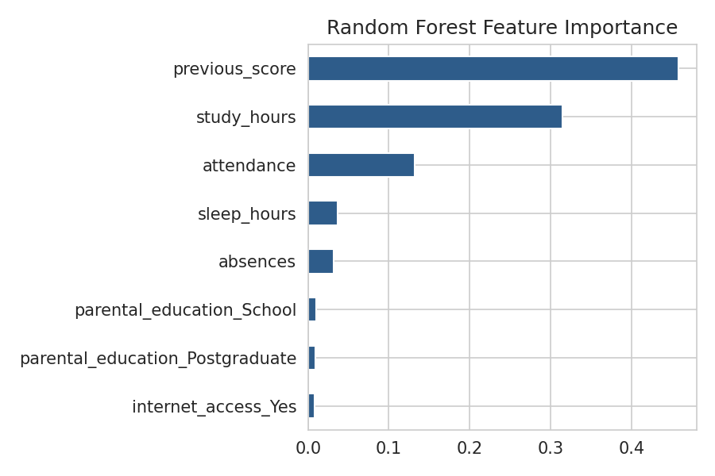
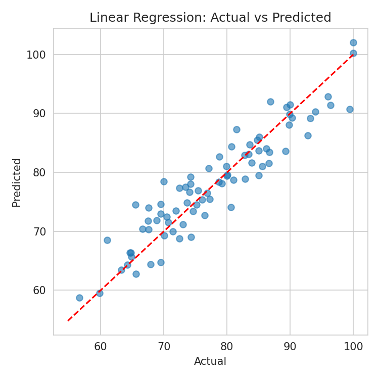

# Student Performance Prediction (SPSS + Python/ML)

A project that predicts a student's final score from study habits, attendance, previous performance and home factors. The analysis is done in two ways: **SPSS** (statistical modelling) and **Python** (machine learning).

## Dataset
`student_data.csv` has 400 records and 8 variables. The target is `final_score` (0-100).

> **Note:** This is a simulated (synthetic) sample dataset created for this project. It is not real student data. To use real data, set `USE_OWN_DATA = True` in the Python script and update the file path and target column.

| Variable | Description |
|---|---|
| study_hours | Weekly study hours |
| attendance | Attendance percentage |
| previous_score | Score in previous exam |
| sleep_hours | Average sleep per night |
| absences | Days absent |
| internet_access | Yes / No |
| parental_education | School / Graduate / Postgraduate |
| final_score | Target variable |

## Models and Results (20% test set)
| Model | R² | MAE | RMSE | 5-fold CV R² |
|---|---|---|---|---|
| Linear Regression | 0.870 | 2.892 | 3.629 | 0.805 |
| Random Forest | 0.787 | 3.922 | 4.641 | 0.689 |

Linear Regression performed best. The most important predictors were previous score, study hours and attendance.




## How to Run

**Python**
```bash
pip install -r requirements.txt
python student_performance_project.py
```
This regenerates the dataset, charts (`fig*.png`) and result CSV files.

**SPSS**
1. Open `student_performance_spss.sps` in SPSS.
2. Change the file path to where `student_data.csv` is saved.
3. Run > All.

## Files
- `student_performance_project.py` - Python/ML code
- `student_performance_spss.sps` - SPSS syntax
- `student_data.csv` - dataset
- `Project_Report.docx` - full report
- `fig1-fig5 *.png` - charts
- `model_results.csv`, `linear_coefficients.csv`, `feature_importance.csv` - outputs

## Tools
Python 3, pandas, scikit-learn, matplotlib, seaborn, IBM SPSS Statistics.
